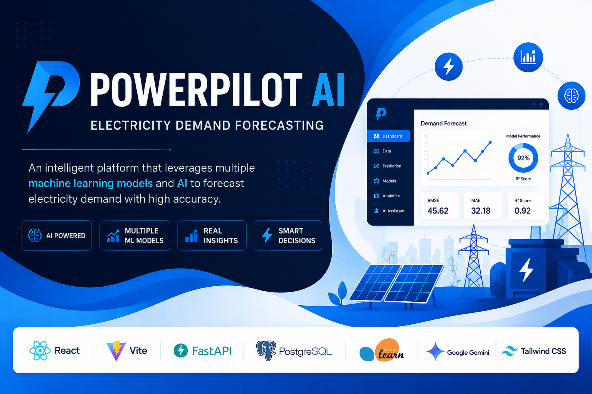
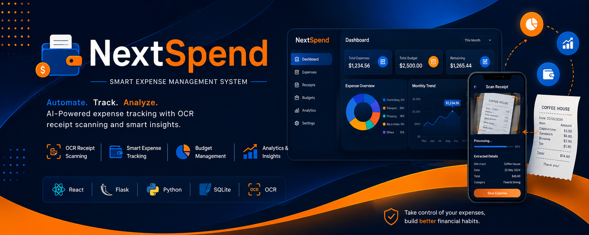
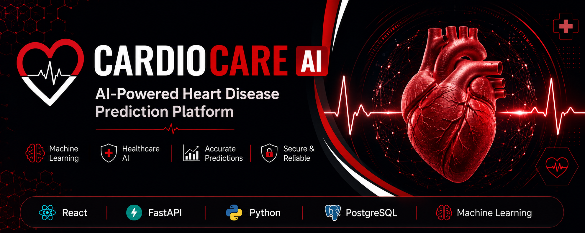
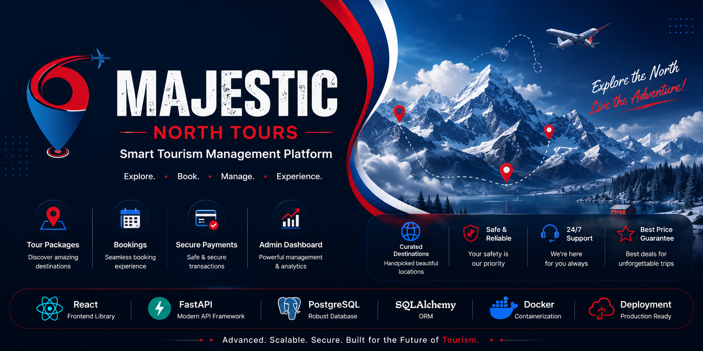
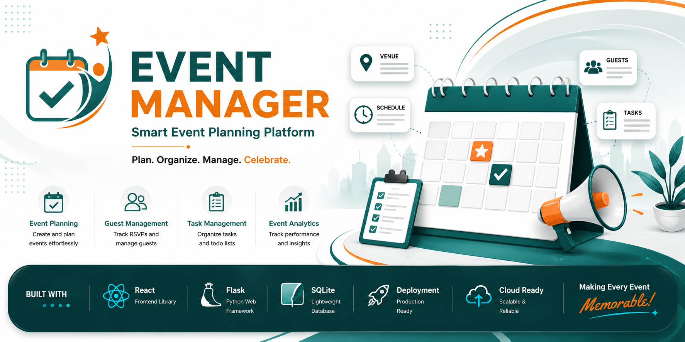

Hi 👋 I'm Zehra Nisar

</h1>

<h3 align="center">

AI & Full Stack Developer

</h3>

Building Intelligent Web Applications with Artificial Intelligence,
Machine Learning and Modern Web Technologies.

---

---

---
# 👩‍💻 About Me

I'm **Zehra Nisar**, an **AI & Full Stack Developer** passionate about building intelligent software that solves real-world challenges.

My work combines **Artificial Intelligence**, **Machine Learning**, and **modern Full Stack Development** to create scalable applications across multiple industries, including **Healthcare, Energy, Finance, Tourism, and Event Management**.

I'm continuously exploring emerging AI technologies, improving my software engineering skills, and building impactful digital solutions that bridge innovation with real-world needs.

---

<i>Designing intelligent software with Artificial Intelligence, Machine Learning, and Modern Full Stack Development.</i>

 
---

# 💼 Professional Identity

## 👩‍💻 Zehra Nisar

### AI Engineer • Full Stack Developer • Machine Learning Enthusiast

*Designing intelligent software through Artificial Intelligence, Machine Learning, and Modern Full Stack Development.*

 

<table align="center">

<tr>

<td width="33%" align="center">

## 🤖

### AI & Intelligence

Artificial Intelligence

Machine Learning

Scikit-learn

Gemini AI

Data Analytics

</td>

<td width="33%" align="center">

## 💻

### Software Engineering

React

JavaScript

Vite

FastAPI

Flask

REST APIs

Node.js

</td>

<td width="33%" align="center">

## ☁

### Cloud & Infrastructure

PostgreSQL

MySQL

SQLite

Supabase

Vercel

Railway

Render

GitHub

Namecheap

</td>

</tr>

</table>

 

### ⚡ Development Toolkit

🐍 **Python** &nbsp;&nbsp;•&nbsp;&nbsp;
☕ **Java** &nbsp;&nbsp;•&nbsp;&nbsp;
⚡ **JavaScript** &nbsp;&nbsp;•&nbsp;&nbsp;
🗄 **SQL**

  

🎓 **BS Computer Science**

📍 **Pakistan**

🚀 **Open to AI, Machine Learning & Full Stack Development Opportunities**

---

### 💡 Building intelligent software powered by AI, engineered with modern technologies, and designed to create real-world impact.

---

🚀 5+ AI & Full Stack Projects • 🤖 Machine Learning Enthusiast • ⚡ FastAPI Expert • ⚛ React Developer • 📊 Data Analytics

---
# 📜 Certifications

<table>

<tr>

<td width="50%">

### 🧠 Deep Learning Specialization

**Platform:** Coursera

Advanced concepts in Deep Learning, Neural Networks, and AI.

</td>

<td width="50%">

### 🤖 Machine Learning Specialization

**Platform:** Coursera

Comprehensive training in Machine Learning algorithms and predictive modeling.

</td>

</tr>

<tr>

<td width="50%">

### 🐍 Python for AI, Data Science and Development

**Platform:** Coursera

Python programming for Artificial Intelligence and Data Science applications.

</td>

<td width="50%">

### 🛡️ Ethical Hacking

**Organization:** LWE

Fundamentals of cybersecurity, penetration testing, and ethical hacking.

</td>

</tr>

<tr>

<td colspan="2">

### 🎓 CS50x Puzzle Day 2026

**Harvard University**

Participated in Harvard University's CS50x Puzzle Day, solving collaborative programming and logical reasoning challenges.

</td>

</tr>

</table>

---
# 🛠 Tech Stack

### 👨‍💻 Programming Languages

### ⚛️ Frontend Development

### ⚙️ Backend Development

### 🗄️ Database

### 🤖 AI & Machine Learning

### ☁️ Deployment & Tools

---
# 🤖 AI Domains
Machine Learning • Predictive Analytics • OCR • AI Chatbots • Explainable AI • Intelligent Automation

---
# 🌍 Development Philosophy

> **"Building AI & Full Stack solutions that create meaningful impact across multiple industries through intelligent software engineering."**

---
# 🚀 Featured Projects

The following projects represent my journey in **Artificial Intelligence, Machine Learning, Full Stack Development, and Modern Software Engineering**.

Each project focuses on solving real-world problems through scalable architecture, clean user experiences, and intelligent technologies.

---
# 🚀 Featured Projects

<table>

<tr>

<td width="42%">

</td>

<td width="58%">

## ⚡ PowerPilot AI

### AI-Powered Electricity Demand Forecasting Platform

An intelligent Full Stack platform that forecasts electricity demand using Machine Learning, interactive analytics, and Google Gemini AI.

### 🛠 Technologies

`React` • `FastAPI` • `PostgreSQL` • `Machine Learning` • `Gemini AI`

 

</td>

</tr>

</table>

---

<table>

<tr>

<td width="42%">

</td>

<td width="58%">

## 💰 NexSpend

### Smart Expense Management Platform

An OCR-powered expense management application featuring intelligent receipt scanning, budgeting, financial analytics, and expense tracking.

### 🛠 Technologies

`React` • `Flask` • `SQLite` • `OCR`

 

</td>

</tr>

</table>

---

<table>

<tr>

<td width="42%">

</td>

<td width="58%">

## ❤️ CardioCare AI

### AI-Powered Heart Disease Prediction Platform

A Machine Learning healthcare solution that predicts cardiovascular disease risk and delivers intelligent health insights through a modern Full Stack application.

### 🛠 Technologies

`React` • `FastAPI` • `Machine Learning`

 

</td>

</tr>

</table>

---

<table>

<tr>

<td width="42%">

</td>

<td width="58%">

## 🏔️ Majestic North Tours

### Smart Tourism Management Platform

A complete Full Stack tourism platform featuring secure authentication, online bookings, tour management, reviews, admin dashboard, and cloud deployment.

### 🛠 Technologies

`React` • `FastAPI` • `PostgreSQL` • `JWT` • `Cloud Deployment`

 

</td>

</tr>

</table>

---

<table>

<tr>

<td width="42%">

</td>

<td width="58%">

## 🎉 Event Manager

### Smart Event Planning Mobile Application

A native Android application built for seamless event scheduling, guest management, task tracking, venue organization, and notifications.

### 🛠 Technologies

`Android Studio` • `Java` • `XML` • `SQLite`

 

</td>

</tr>

</table>

---
# 🏅 GitHub Profile Metrics

---                

# 📈 Contribution Activity

---
# 🐍 Contribution Snake

  

---

# 📫 Let's Connect

---
---

# 🌟 Thanks for Visiting

 

<h3>🚀 Building Intelligent Software with AI & Full Stack Development</h3>

Passionate about creating scalable applications powered by
<b>Artificial Intelligence</b>,
<b>Machine Learning</b>, and
<b>Modern Full Stack Technologies</b>.

 

🤝 <b>Open to collaborations, innovative projects, and exciting opportunities.</b>

⭐ <b>If you enjoy my work, consider starring my repositories.</b>

 

---

<i>"Every great product begins with a single idea. Let's build the next one together."</i>

